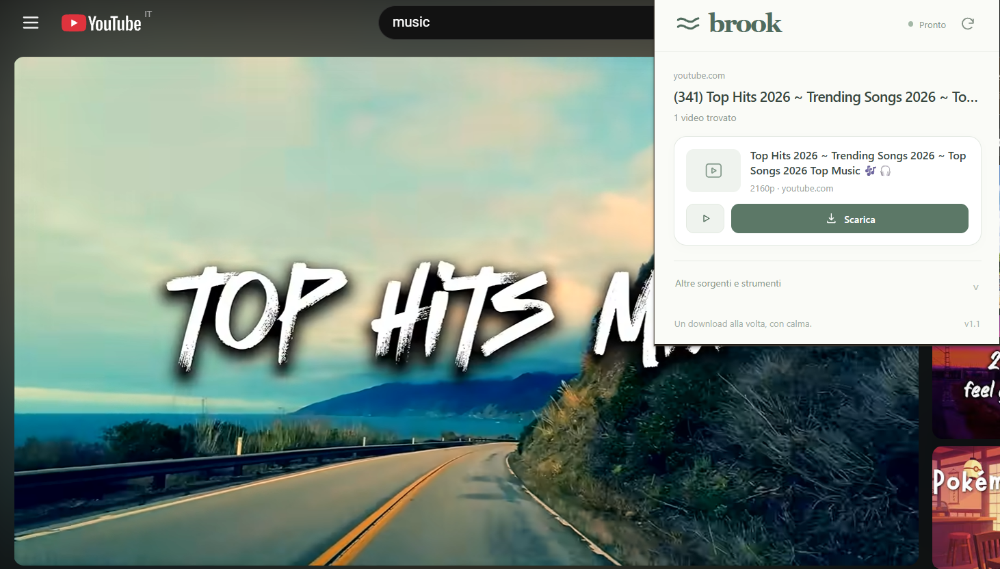
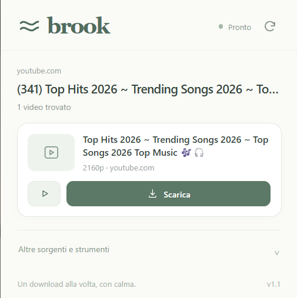
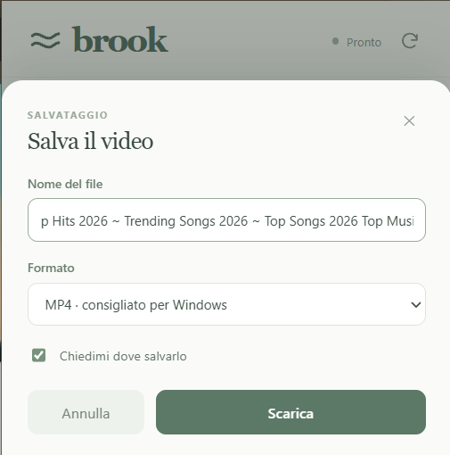
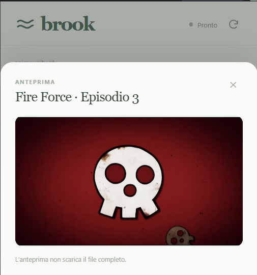

<div align="center">
  

  # Brook

  **Detect. Preview. Download.**

  A lightweight Chrome extension for discovering and saving supported video resources from the browser.

  
  
  
  

</div>

Brook detects media URLs from web pages and network requests. It can list available sources, show a preview, and download **direct video files through Chrome**. For **HLS (`.m3u8`)**, **DASH (`.mpd`)**, and advanced media analysis, Brook uses an optional local engine built with **Python, yt-dlp, and FFmpeg**.

> [!NOTE]
> Brook is an **experimental project**, not a universal video downloader. Compatibility depends on the website and media format. It does **not** bypass DRM or retrieve cookies or login credentials. Only download content you own or are authorized to save.

## Preview

<div align="center">
  
  <p><sub>Brook detects media in the current browser tab.</sub></p>
</div>

<table>
  <tr>
    <td align="center" width="50%">
      <br>
      <sub><b>1. Discover media</b> — see what Brook found on the page.</sub>
    </td>
    <td align="center" width="50%">
      <br>
      <sub><b>2. Save your video</b> — select a filename, format and destination when supported.</sub>
    </td>
  </tr>
</table>

<details>
<summary><b>More screenshots — video previews</b></summary>

<br>
<table>
  <tr>
    <td align="center" width="50%"></td>
    <td align="center" width="50%"></td>
  </tr>
</table>

The examples show third-party page content for illustration; Brook is not affiliated with the featured sites or content owners.
</details>

## Features

- **Automatic media discovery:** identifies supported media resources from page HTML and network activity.
- **Clean, compact interface:** displays detected items with available details such as title, resolution and duration.
- **Direct downloads:** saves recognized direct files (for example MP4 or WebM) using Chrome's built-in download API, **without installing Python**.
- **Streaming support:** processes HLS and DASH sources through the optional local engine.
- **Video previews:** plays directly available previews or generates previews locally with FFmpeg when supported.
- **Download options:** lets you choose the filename, output format, save location, and available quality/audio tracks when the source and engine expose them.
- **Additional tools:** use page analysis and source inspection when automatic discovery is not enough.

### What needs the native engine?

| Capability | Chrome extension only | Local engine required |
| --- | :---: | :---: |
| Detect supported media resources | ✅ | — |
| Download recognized direct video files | ✅ | — |
| Download HLS / DASH streams | — | ✅ |
| Advanced page/source analysis | — | ✅ |
| FFmpeg-generated previews and processing | — | ✅ |

## Installation

### 1. Install the Chrome extension

**Requirements:** Google Chrome **116+**.

1. Select **Code → Download ZIP** on this repository, or download the source ZIP from a [Release](../../releases).
2. Extract it into a **permanent folder** on your computer. If you later configure the native engine, do not move or delete that folder without reinstalling the integration.
3. Open `chrome://extensions` in Chrome.
4. Turn on **Developer mode** (top-right corner).
5. Click **Load unpacked** and select the **`extension`** folder inside the extracted project — not the repository root.
6. Optionally pin Brook from the Chrome extensions menu.

Open a page containing a supported video, start playback if necessary, and select Brook. **Direct-file downloads can work immediately**; the next step is only for advanced features.

> [!TIP]
> Each unpacked installation has its own **extension ID** (visible at `chrome://extensions`). You will need this ID if you enable the native engine.

### 2. Optional: enable HLS / DASH and advanced tools

The native engine uses Chrome **Native Messaging** to communicate with a locally installed Python program. It is **not** installed automatically when you load the extension.

#### Windows

1. Install **Python 3** and confirm that PowerShell recognizes `py -3 --version`.
2. Install yt-dlp:

   ```powershell
   py -3 -m pip install --upgrade yt-dlp
   ```

3. Install **FFmpeg**, including `ffprobe`, and make both accessible on your `PATH`. Check with `ffmpeg -version` and `ffprobe -version`.
4. Go to `chrome://extensions`, find Brook, and copy the 32-character **ID**.
5. Open PowerShell in the project's root folder and run:

   ```powershell
   powershell -ExecutionPolicy Bypass -File .\native\install_windows.ps1 -ExtensionId "YOUR_EXTENSION_ID"
   ```

6. Fully close and reopen Chrome. Brook should show **Pronto** (Ready) when the engine is connected.

The installer creates a machine-specific Native Messaging configuration in the `native/` folder and registers it in Windows. Do **not** publish this generated file; it is excluded from Git. The internal host name `com.streamscout.personal` is kept for compatibility with older installations.

#### macOS

1. Install **Python 3**, **yt-dlp**, and **FFmpeg/FFprobe** (for example, FFmpeg using Homebrew: `brew install ffmpeg`).
2. Install yt-dlp with the Python interpreter that will be used by the host:

   ```bash
   python3 -m pip install --upgrade yt-dlp
   ```

   If your Python installation prevents system-level `pip` changes, use a suitable Python environment before running the installer.
3. Find Brook's **extension ID** at `chrome://extensions`.
4. In Terminal, from the project root, run:

   ```bash
   bash native/install_macos.sh YOUR_EXTENSION_ID
   ```

5. Fully close and reopen Chrome, then check the engine status in Brook.

If you want the native **Choose where to save** dialog, Python must provide `tkinter`; otherwise, disable manual folder selection.

**Linux:** no dedicated native-engine installer is included yet. The unpacked Chrome extension can still be loaded manually.

## Usage

1. **Open a supported video page** and, if needed, start playback so the media requests become visible.
2. **Open Brook** from the browser toolbar to review the detected media.
3. **Preview** an item when available.
4. **Download:** choose the filename and format/options offered for that source, then confirm the save location if prompted.
5. For HLS/DASH content, connect the **native engine** first. The additional source-analysis tools can help discover available streams and tracks.

By default, native-engine downloads are stored in `Downloads/Brook/` unless you choose another folder.

### Troubleshooting

| Problem | What to check |
| --- | --- |
| **Engine offline / Motore offline** | Install Python, yt-dlp and FFmpeg; run the native installer with the correct extension ID; restart Chrome. |
| **No video detected** | Play the video, refresh the page and try again. Not all websites expose supported sources. |
| **Download options missing** | Quality, audio languages and formats depend on what the source and analysis provide. |
| **Folder picker does not open on macOS** | Ensure the configured Python supports `tkinter`, or disable manual destination selection. |
| **Native engine stopped working after moving the project** | Re-run the OS-specific installer from the new permanent folder. |

## Project structure

```text
Brook/
├── extension/             # Chrome extension (Manifest V3)
├── native/                # Python engine and Native Messaging installers
├── docs/images/           # README screenshots
├── tests/                 # Automated tests
├── .github/workflows/     # GitHub Actions tests
├── README.md
├── PRIVACY.md
├── LICENSE
└── requirements.txt
```

### Run tests

No real video downloads are performed by these tests:

```bash
python -m unittest discover -s tests -v
node tests/test_background.cjs
```

Node.js is only required to run the JavaScript tests, **not** to use Brook.

## Privacy and permissions

Brook requests access to browser tabs, web requests, downloads and Native Messaging to discover media and perform its features. This includes permissions for HTTP/HTTPS pages. The native engine may contact the original media website to inspect/download a source.

See [PRIVACY.md](PRIVACY.md) for the project's current privacy information. Never share personal Native Messaging manifests, authentication tokens, signed URLs or private media links in Issues.

## Contributing

Bug reports, feature suggestions and pull requests are welcome. Please [open an Issue](../../issues) and include your operating system, Chrome version, Brook version, steps to reproduce and **non-sensitive** logs. Do not include private links, cookies, credentials or personal information.

## License

Released under the [MIT License](LICENSE). See the license for redistribution and commercial-use terms.

---

<div align="center"><sub>Brook v1.1.0 · An independent, experimental open-source project.</sub></div>
